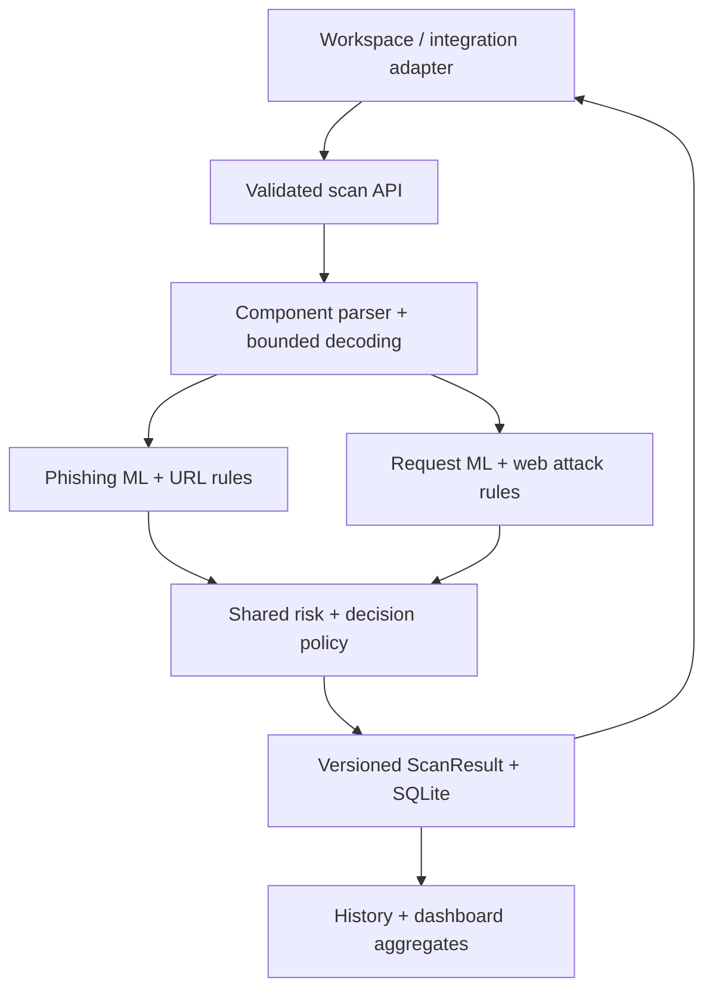

# Unified architecture

All input formats enter `POST /api/v1/scans`. The frontend renders one shared ScanResult rather than separate phishing and request tools.

## Boundaries

- `schemas.py`: strict input contract and unified versioned result format.
- `parsing.py`: validates HTTP(S) URLs, origin-form HTTP targets, supported body formats, duplicates, and complexity limits. Components retain their identities. Two inspection passes perform percent decoding where appropriate, HTML entity decoding, and Unicode normalization. Original form plus separators are handled before percent decoding. Unsupported deeper encodings and invalid UTF-8 require review.
- `detectors/models.py`: checks trusted local artifacts against the manifest and adapts both models into numeric signals. Missing/corrupt models produce incomplete coverage and Review, not a false successful scan.
- `detectors/rules.py`: multi-category request patterns with stable IDs, component locations, inspection views, and offsets.
- `detectors/phishing_rules.py`: generic, explainable destination shape indicators; no claims about ownership or live reputation.
- `engine.py`: fans out the same normalized input and combines findings once. URL path/query can trigger web-attack findings alongside phishing analysis. Host headers in HTTP requests do not become phishing destinations.
- `policy.py`: category score = maximum finding for that category; total risk = maximum applicable category score. Unsupported categories are null. Model uncertainty or incomplete coverage requires Review. Explicit strict demo rules can recommend Block only with complete analysis.
- `storage.py`: parameterized SQLite persistence, filtering, pagination, aggregate risk, overlapping rule category counts, UTC daily trends, and deduplicated adapter reports.
- `api.py`: bounds request bodies at 64 KiB, validates content at 10,000 characters, sanitizes validation errors, restricts hosts, and serves both APIs and static frontend.
- `static/`: dependency-free dashboard, composer, explanations, history reopening, and JSON export; untrusted values are inserted via textContent.
- `demo-app/`: optional Node adapter scans before its harmless handler. Enforce and monitor modes use the same API and record authenticated action acknowledgements.

## Failure behavior

Malformed required input is rejected with 422. Unsupported body encodings, duplicate JSON keys, repeated headers, or complexity limits yield partial analysis and Review. A missing model makes `/ready` return 503 while `/health` remains a liveness probe. SQLite errors fail the scan request rather than reporting a stored success. The Node adapter denies on scanner timeout/outage, returns input errors separately, and marks failed acknowledgements unrecorded.

## Development baseline and next work

The request ML fixture and legacy phishing model make the foundation runnable. Independent data splits, held-out performance, probability calibration, phishing feature repairs, authentication, and a production traffic adapter remain future work. Historical roadmap items are not statements that those features exist today.
